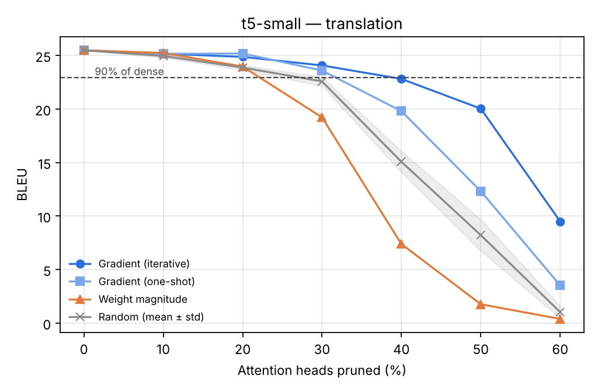
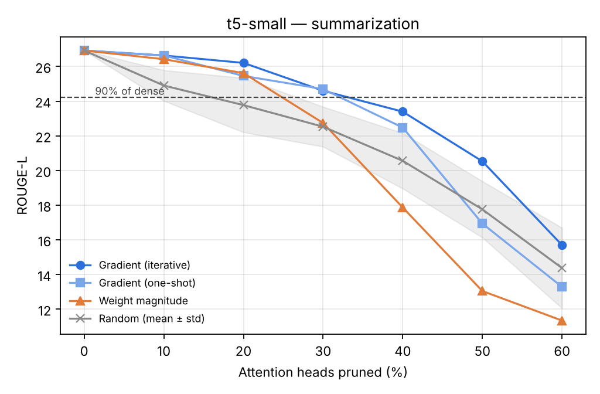
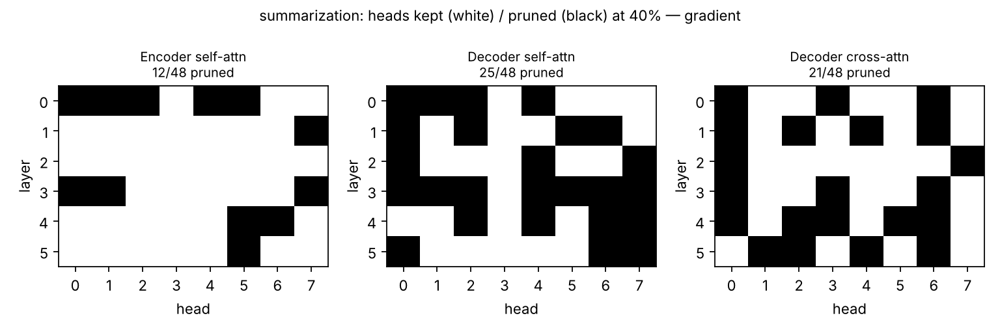
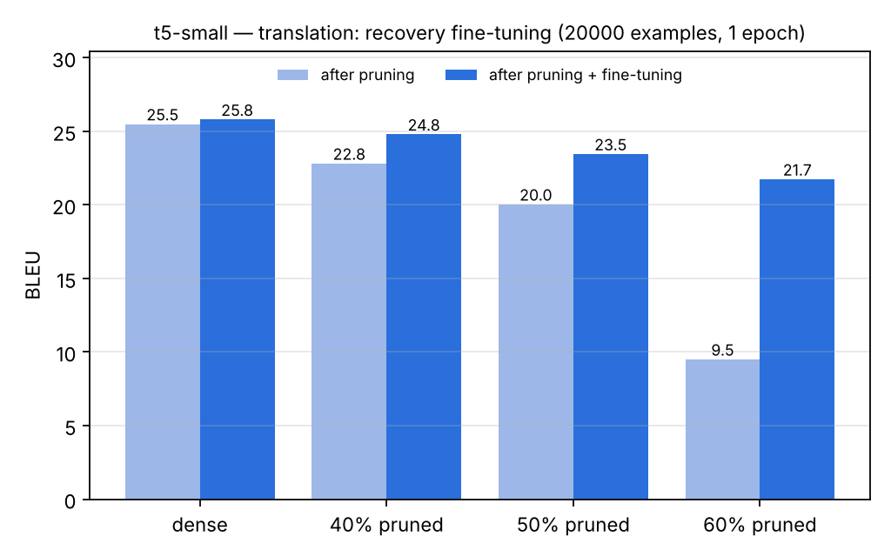
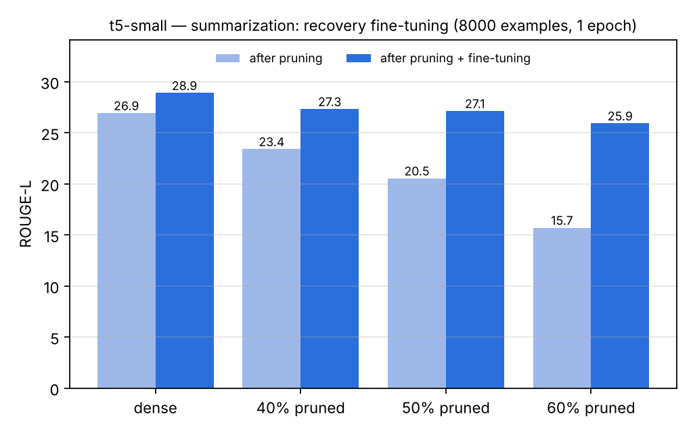

# Attention-Head Pruning in T5

How many of T5's attention heads does it actually need, and does removing them make the model cheaper to run?

This project scores all 144 attention heads of `t5-small` (encoder self-attention, decoder self-attention and decoder cross-attention, 48 each) using gradient-based importance ([Michel et al., 2019](https://arxiv.org/abs/1905.10650)). It prunes them iteratively, compares against one-shot, weight-magnitude and random baselines, physically removes the pruned heads to measure real efficiency, and then fine-tunes the pruned models to recover quality.

Tasks: **English→Romanian translation** (WMT16, BLEU) and **news summarization** (CNN/DailyMail, ROUGE-L). All experiments ran on a single NVIDIA T4.

## Key results

| 40% of heads removed | Translation BLEU | Summarization ROUGE-L |
|---|---|---|
| Dense model | 25.49 | 26.92 |
| Gradient pruning (iterative) | **22.81** (89%) | **23.40** (87%) |
| Random pruning (mean of 3 seeds) | 15.07 (59%) | 20.56 (76%) |
| Weight-magnitude pruning | 7.39 (29%) | 17.87 (66%) |
| Gradient pruning + recovery fine-tuning | **24.80** (96% of dense + same FT) | **27.31** (95% of dense + same FT) |

- Gradient-based pruning beats random by **7.7 BLEU at 40%** and **11.8 BLEU at 50%** sparsity.
- Short recovery fine-tuning (about 4 minutes on a T4) brings a 60%-pruned model from **9.5 to 21.7 BLEU**.
- Removing 40% of heads cuts **12.6% of parameters, 14% of FLOPs and 16% of peak GPU memory**, but gives **no latency speed-up**. The [findings](#findings) explain why.

<p align="center">
  
  
</p>

## Findings

**1. Iterative gradient scoring is clearly the best criterion.** Translation BLEU at each pruning level:

| Method | 10% | 20% | 30% | 40% | 50% | 60% |
|---|---|---|---|---|---|---|
| Gradient (iterative) | 25.16 | 24.88 | 24.08 | **22.81** | **20.04** | **9.50** |
| Gradient (one-shot) | 25.16 | 25.19 | 23.60 | 19.81 | 12.33 | 3.52 |
| Weight magnitude | 25.24 | 23.97 | 19.22 | 7.39 | 1.76 | 0.39 |
| Random (3 seeds) | 24.96 | 23.88 | 22.58 | 15.07 | 8.22 | 1.03 |

Up to 20%, every method is fine, so many heads can be removed almost for free. Past 30%, the methods separate sharply. Recomputing importance after each pruning step beats scoring once (+3.0 BLEU at 40%, +7.7 at 50%): once some heads are removed, the remaining heads' importance changes. Summarization ([`results/SUMMARY.md`](results/SUMMARY.md)) shows the same overall picture: iterative gradient pruning is best from 40% onward and weight magnitude is worst, though there one-shot gradient falls slightly below random at 50–60%.

**2. Weight magnitude is worse than random.** From 30% sparsity onward for translation, and from 40% for summarization, removing the heads with the smallest weights hurts more than removing heads at random. A head's weight norm says little about how much the model relies on it.

**3. Most of the redundancy is in the decoder, and which heads matter depends on the task.** At 40% sparsity, gradient pruning removed 21/48 decoder self-attention heads for translation and 25/48 for summarization. Summarization kept more encoder heads (12 pruned vs. 17 for translation), which fits a task that has to read long articles. Only 31 of the 58 pruned heads are shared between the two tasks (Jaccard overlap 0.36).

<p align="center"></p>

**4. Fine-tuning recovers most of the loss, but it must be measured against a fine-tuned dense model.** Each pruned model was fine-tuned for one epoch on a subset of its task's training set. The dense model was given the same fine-tuning as a control:

| Model | Translation BLEU (pruned → FT) | % of dense+FT | Summarization ROUGE-L (pruned → FT) | % of dense+FT |
|---|---|---|---|---|
| Dense | 25.49 → 25.80 | 100% | 26.92 → 28.89 | 100% |
| 40% pruned | 22.81 → 24.80 | 96% | 23.40 → 27.31 | 95% |
| 50% pruned | 20.04 → 23.45 | 91% | 20.53 → 27.13 | 94% |
| 60% pruned | 9.50 → 21.74 | 84% | 15.70 → 25.92 | 90% |

Without the control, the pruned summarization models would appear to *beat* the original model (27.31 vs. 26.92). In fact the extra task training alone raises the dense model to 28.89, so against an equally trained dense model the honest figure is 95%.

<p align="center">
  
  
</p>

**5. Fewer FLOPs did not mean lower latency.** Translation, T4 GPU, FP32, 128 input tokens, 64 greedy output tokens:

| Model | Params | Attention params | GFLOPs | Peak memory (batch 16) | Latency, batch 1 | Latency, batch 16 |
|---|---|---|---|---|---|---|
| Dense | 60.5 M | 18.9 M | 10.91 | 328 MB | 642 ms | 661 ms |
| Heads masked, not removed (60%) | 60.5 M | 18.9 M | 10.91 | 328 MB | 701 ms | 703 ms |
| 40% heads removed | 52.9 M | 11.3 M | 9.35 | 274 MB | 676 ms | 687 ms |
| 60% heads removed | 49.2 M | 7.6 M | 8.50 | 250 MB | 666 ms | 693 ms |

- **Attention is only 31% of `t5-small`'s parameters.** Embeddings and feed-forward layers make up the rest, so 40% head sparsity is about 13% model compression.
- **Generation is overhead-bound.** Batch 16 takes about as long as batch 1, so the GPU is far from saturated. Time goes on per-token, per-layer kernel launches during step-by-step decoding, not on the matrix multiplications that pruning shrinks. Masked heads are even slightly *slower* because of the hook overhead.
- **Memory still shrinks.** The pruned model needs less weight memory and a smaller key/value cache: activation memory drops from about 97 MB to 72 MB at 40%.
- **Where real speed-ups would come from:** larger models or batches, or pruning whole layers or feed-forward blocks.

## Method

| Component | Details |
|---|---|
| Head mask | A forward pre-hook on each attention block's output projection scales each head's output by a mask value ξ<sub>h</sub> (`t5prune/heads.py`). It works across `transformers` versions. |
| Gradient importance | I<sub>h</sub> = Σ<sub>batches</sub> \|∂L/∂ξ<sub>h</sub>\|, a first-order estimate of the loss change if head *h* is removed. Scores are L2-normalised per layer and ranked globally. |
| Iterative pruning | Prune to 10%, re-score, prune to 20%, and so on. Each attention layer keeps at least one head. |
| Baselines | One-shot gradient, weight magnitude (norm of the head's Q/K/V/O slices), and random (3 seeds, mean ± std). |
| No data leakage | Importance is computed on 256 **validation** examples. Quality is measured on **test** examples (500 for translation, 300 for summarization), with beam search (4 beams). |
| Physical pruning | The pruned heads' rows are sliced out of Q/K/V and their columns out of O (`t5prune/physical.py`). T5 shares one relative-position-bias tensor across layers, so each layer selects only its kept heads from it. Tests verify that the pruned model gives **identical logits and generations** to the masked model. |
| Recovery fine-tuning | One epoch with AdamW at lr 1e-4: 20k sentence pairs for translation, 8k articles for summarization. The dense model gets the same fine-tuning as a control. |
| Efficiency | Parameters, FLOPs (`torch.utils.flop_counter`), median generation latency over 10 runs with a fixed output length, and peak GPU memory. Each model is measured alone on the GPU. |

## Reproduce

```bash
pip install -r requirements.txt
python tests/test_pruning.py          # correctness tests on a tiny random T5, no download

python run_sweep.py --task translation
python run_sweep.py --task summarization --n_eval 300
python run_benchmark.py --task translation --method gradient --all_levels
python run_finetune.py --task translation
python run_finetune.py --task summarization
python make_plots.py                  # figures + results/SUMMARY.md
```

Add `--quick` to `run_sweep.py` or `run_finetune.py` for a few-minute smoke test. Ready-to-run notebooks for Kaggle (2×T4: each task runs on its own GPU in parallel) and Colab are in [`notebooks/`](notebooks). On Kaggle, the sweep takes about 40 minutes and the fine-tuning about 30.

## Repository layout

```
t5prune/heads.py        head masks via hooks on the attention output projection
t5prune/importance.py   gradient / magnitude / random scores, iterative prune_to()
t5prune/physical.py     physically remove heads (handles T5's shared position bias)
t5prune/data.py         datasets, generation, BLEU / chrF / ROUGE
t5prune/benchmark.py    params, FLOPs, latency, throughput, memory
t5prune/plots.py        figures
run_sweep.py            pruning sweep        → results/sweep_<task>.json
run_benchmark.py        efficiency benchmark → results/benchmark_<task>_gradient.json
run_finetune.py         recovery fine-tuning → results/finetune_<task>.json
make_plots.py           figures + results/SUMMARY.md
tests/test_pruning.py   correctness tests
notebooks/              Kaggle and Colab notebooks
results/                all raw results, figures and tables from the runs above
```

## Reference

P. Michel, O. Levy, G. Neubig. *Are Sixteen Heads Really Better than One?* NeurIPS 2019. [arXiv:1905.10650](https://arxiv.org/abs/1905.10650)
